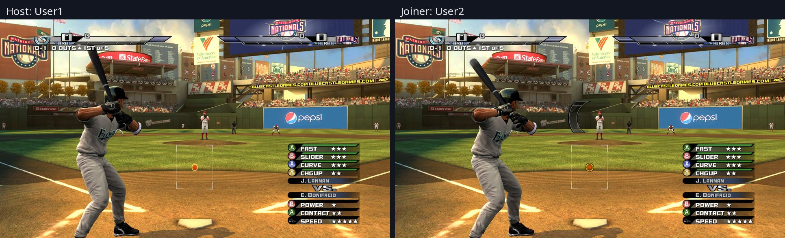
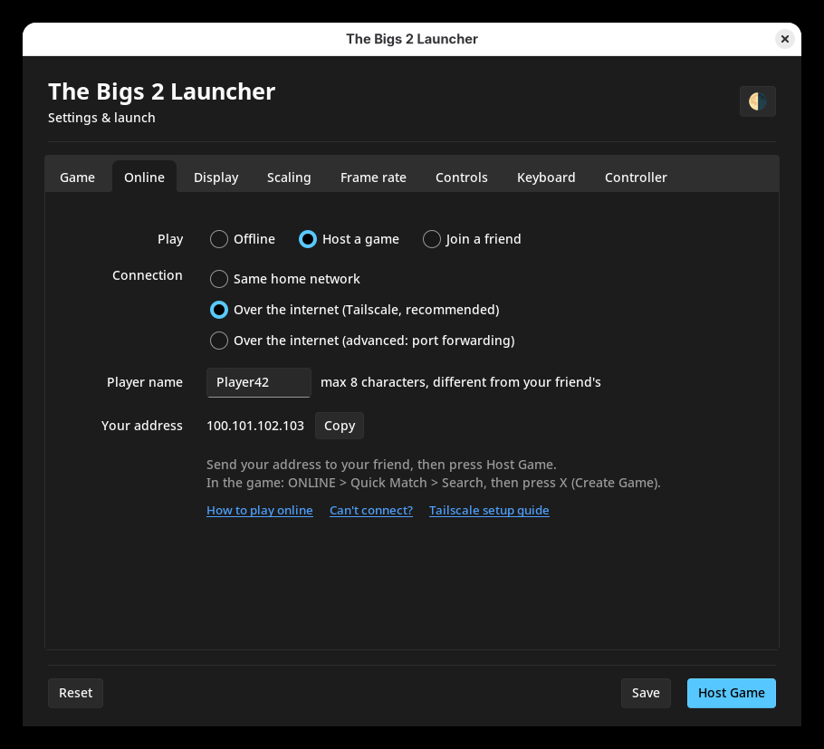

# The Bigs 2 Online

Play *The Bigs 2* (Xbox 360, 2K Sports, 2009) **online against a friend** again,
on Windows and Linux, and (experimental) macOS.

Based on [The Bigs 2 Recompiled](https://github.com/mdomangue26/The-Bigs-2-Recompiled)
by Michael (mdomangue26), a native PC port of the game. This fork brings back
the game's own online mode: two players meet in the Game Room, pick their teams
and play a full match, in sync.



> **You need your own copy of the game** (a disc image, `.iso`). Neither this
> repo nor its releases contain game assets; see [Legal](#legal).

## Download and install

1. Download the file for your system from
   **[Releases](https://github.com/MatRanc/The-Bigs-2-Recomp-Online/releases)**:

   | System | File |
   |---|---|
   | Windows 10/11 (64-bit) | `TheBigs2-windows-x64.zip` |
   | Linux (and Steam Deck) | `TheBigs2-linux-x64.tar.gz` |
   | macOS (Apple Silicon) | **Experimental**, build it yourself for now ([see below](#macos-experimental)) |

2. Unpack it into a folder of its own and put your `.iso` next to it.
3. Open **The Bigs 2 Launcher** in that folder. Nothing else to install.
   - **Windows:** `The Bigs 2 Launcher.exe`. If Windows warns about an
     unrecognised app: *More info* > *Run anyway*.
   - **Linux:** `The Bigs 2 Launcher`.
   - **macOS:** `The Bigs 2 Launcher.app`. It isn't signed: the first time,
     right-click it > *Open*.
4. Press **Play Offline** to try it. The first start asks for your disc image
   (an `.iso` next to the game is preselected) and copies its files once.

**Requirements:** a GPU with Vulkan support and a current driver. Linux needs
glibc 2.38 or newer (Ubuntu 24.04, Fedora 39, current Arch or SteamOS).
Windows needs 64-bit Windows 10 or 11.

### Steam Deck

Use `TheBigs2-SteamDeck-x86_64.AppImage` from the Linux download. It's the same
game with defaults suited to the Deck: 1x resolution (fills the screen), lighter
settings, and the keyboard turned off as a controller (Steam Input sends key
presses).

1. In Desktop Mode, make a folder (e.g. `~/Games/TheBigs2`) and put the
   AppImage in it, ideally with your `.iso`.
2. *Add a Non-Steam Game to My Library*, pick the AppImage, switch to Game
   Mode and play. The setup screen works with the Deck's controls and
   touchscreen and can browse to an SD card.
3. Quit with **View + Menu held 2 seconds**, or EXIT GAME on the main menu.
   **View + Y held a second** opens the settings menu.
4. On the Deck OLED, set the refresh rate to **60 Hz** in the Quick Access
   performance menu, or motion judders.

It runs at 30 fps. With `frame_rate = 60` it holds 60 in gameplay and slows
down in transitions. The first minutes can stutter while shaders compile.

### macOS (experimental)

Build it yourself on an Apple Silicon Mac ([docs/BUILDING.md](docs/BUILDING.md#macos-on-the-mac)).
Online play with a PC works, but there are graphics glitches and matches run
slower.

## Play online with a friend

Both of you need this build and your own copy of the game. Pick how you connect:

| Where is your friend? | Pick in the launcher | Setup |
| --- | --- | --- |
| Same house (same router or Wi-Fi) | Same home network | None |
| Anywhere else | Over the internet (Tailscale) | [A free app, 5 minutes once](docs/PLAY_ONLINE.md#set-up-tailscale) |
| Anywhere else, no extra app | Over the internet (port forwarding) | [The host changes router settings](docs/PLAY_ONLINE.md#port-forwarding) |

1. **Host:** in the launcher's **Online** tab pick **Host a game**, send your
   friend the address shown under *Your address*, and press **Host Game**.
2. **Friend:** pick **Join a friend**, paste the host's address, and press
   **Join Game**.
3. **In the game, both:** ONLINE > Quick Match > Search. The host presses
   **X (Create Game)**, and the friend lands in the host's Game Room.



The full steps, with Tailscale setup: **[Play online](docs/PLAY_ONLINE.md)**.

### Can't connect?

See the checklist in [Play online](docs/PLAY_ONLINE.md#cant-connect).

## Features

- **Online play** against a friend, with a launcher to set it up.
- **Sharper picture**: 2x (1440p) by default, up to 4K; experimental 60 fps in
  matches.
- **Settings menu in the game's own style** (RECOMP SETTINGS on the main menu,
  F4, or hold Back + Y); the launcher edits the same settings.
- **Keyboard controls** and **controller button remapping**.
- **Portable**: settings, saves and logs live next to the game. Saving and
  loading work.

## Key commands

| Keyboard | Controller | Does |
|---|---|---|
| F4 | hold Back + Y (1 second) | Settings menu |
| F10 | hold Back + Start (2 seconds) | Quit the game |
| F3 | | Overlay with the frame rate |
| F7 / Backtick | | Achievements / console |

You can also quit with **EXIT GAME** on the main menu.

**In the settings menu:** LB / RB (Page Up / Page Down) switch tabs, up and
down pick a setting, left and right change it. Start (Ctrl+S) saves, Y saves
and quits, B (Escape) closes. Some settings apply at once, the others after a
restart; the menu marks which.

### Playing with the keyboard

The keyboard works as player 1's controller, alongside a gamepad:

| Controller | Keys |
|---|---|
| A / B / X / Y | `;` or Space / `'` or Backspace / L / P |
| LB / RB | 1 / 3 |
| LT / RT | Q or I / E or O |
| Back / Start | Z or Tab / X or Return |
| Left stick (click) | W A S D (F) |
| Right stick (click) | arrow keys (K) |
| D-pad | Shift + arrow keys |

Change the keys on the settings menu's **Keyboard** tab, and remap controller
buttons on its **Controller** tab (e.g. swap A and B). Button remapping takes
effect after a restart.

## Settings

The settings menu and the launcher edit `config/thebigs2.toml`. You can also
edit the file by hand: every setting is listed in it with an explanation. The
main ones:

| Setting | Default | |
|---|---|---|
| `fullscreen` | `true` | `false` for a window |
| `display_resolution` | `"desktop"` | Window size or fullscreen mode, e.g. `"1920x1080"` |
| `resolution_scale` | `2` | Render scale: `1` = 720p, `2` = 1440p, `3` = 4K |
| `frame_rate` | `30` | `60` for 60 fps in matches (**experimental**; use with `resolution_scale = 1`) |
| `present_effect` | `"bilinear"` | Upscaling: `bilinear`, `cas` or `fsr` |
| `present_letterbox` | `true` | Keep 16:9 with black bars |
| `mnk_mode` | `true` | Keyboard plays as player 1 |

Delete the file to get a fresh one with the defaults. For one run, any setting
can also be given on the command line, as `--name=value`.

Everything the game writes stays in its folder:

```
game/      the extracted game files
config/    thebigs2.toml (settings), launcher preferences
saves/     profile, save games, achievements
cache/     shader cache
logs/
```

If the folder can't be written to, the game uses `~/.config/thebigs2` and
`~/.local/share/thebigs2` (Linux) or `%APPDATA%\thebigs2` (Windows) instead.

## Troubleshooting

- After a crash or a black screen, check `logs/`. An old settings file from
  an earlier build can cause trouble; deleting it resets everything.
- For smooth motion, use a 60 Hz or 120 Hz display mode, or VRR / G-Sync.
- Online problems: see [Can't connect?](docs/PLAY_ONLINE.md#cant-connect).

## For developers

Building, packaging and where the downloads come from:
[docs/BUILDING.md](docs/BUILDING.md). How the online mode works and how to test
it: [docs/ONLINE.md](docs/ONLINE.md).

## Credits

- **Michael (mdomangue26)**: [The Bigs 2 Recompiled](https://github.com/mdomangue26/The-Bigs-2-Recompiled),
  the PC port this fork builds on, and the SDK fixes it needs.
- The **[ReXGlue SDK](https://github.com/rexglue/rexglue-sdk)** authors and
  contributors.
- [sv-ttk](https://github.com/rdbende/Sun-Valley-ttk-theme) for the launcher's
  theme (MIT).

## Legal

**The source code** in this repo contains nothing from the game: no executable
(`default.xex`), no disc contents, no recompiled output, no captures or memory
dumps. It holds the port's own code and describes how the game's online mode
talks to the other player, so people can keep playing a game they own.

**The releases** contain the game's program translated to run natively on PC
(that is what a static recompilation is; building one needs the original
executable), but **no game assets**: graphics, audio, stadiums and rosters come
from your own disc image when you first start the game. As with other
recompilation projects, the original game is required to build or run this
project. *The Bigs 2* is © 2K Sports / Take-Two Interactive;
MLB marks are the property of Major League Baseball. The logo used for the
icons is a trademark of its owners. Not affiliated with 2K, Take-Two or MLB.

## License

The port's own code is public domain ([Unlicense](LICENSE)). The game itself,
the fonts and the SDK keep their own terms; see [LICENSE](LICENSE).
