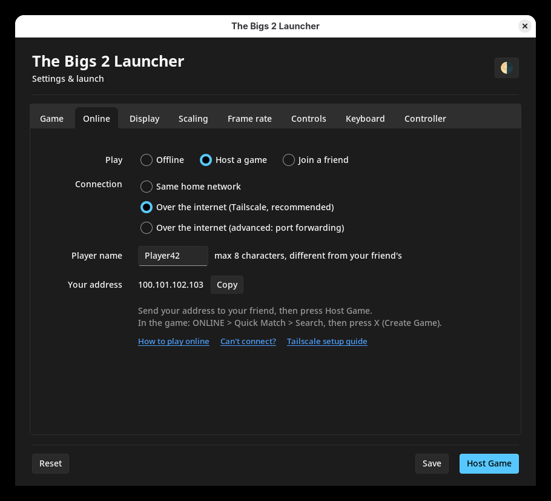
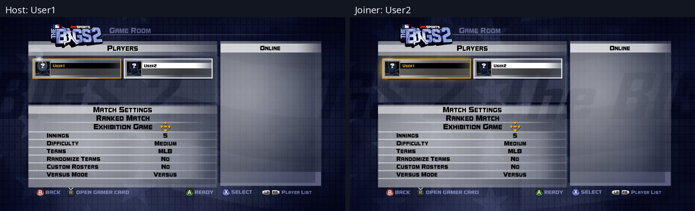
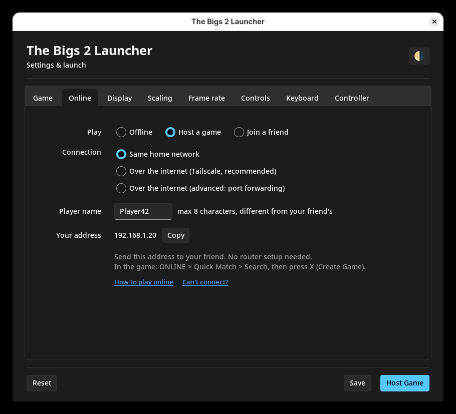

# Play online with a friend

Both of you need this build and your own copy of the game. First, pick how you
connect:

| Where is your friend? | Pick in the launcher | Setup |
| --- | --- | --- |
| Same house (same router or Wi-Fi) | [Same home network](#same-home-network) | None |
| Anywhere else | [Over the internet (Tailscale)](#set-up-tailscale) | A free app, 5 minutes once |
| Anywhere else, no extra app | [Over the internet (port forwarding)](#port-forwarding) | The host changes router settings |

## Playing

1. **Host:** in the launcher's **Online** tab pick **Host a game** and your
   connection, then send your friend the address shown under *Your address*
   (**Copy** puts it on the clipboard). Press **Host Game**.
2. **Friend:** pick **Join a friend** and the same connection, paste the host's
   address, and press **Join Game** (after the host has started).
3. **In the game, both:** ONLINE > Quick Match > Search. The host sees
   *No Game Rooms found*: press **X (Create Game)**. The friend lands in the
   host's Game Room.
4. Both press **A (Ready)**. In Team Setup move your controller to a side with
   the d-pad, pick your team and uniform, then the pitcher and lineup. The host
   picks the stadium, and the match starts.

Player names: up to 8 characters, and the two of you need different names.
The game runs in lockstep (each side waits for the other), so if one PC
stutters, both do.

## Set up Tailscale

Tailscale is a free app that makes two PCs act as if they were on the same home
network. Nothing to set up on your router.

Both players:

1. Download Tailscale from [tailscale.com/download](https://tailscale.com/download)
   and install it.
2. Click the Tailscale icon next to the clock (on Windows it may hide under the
   **^** arrow) and choose **Log in**. Sign in in the browser with a Google,
   Microsoft, GitHub or Apple account, then click **Connect**.

Then the host shares their PC with the friend:

3. Open the [Tailscale admin console](https://login.tailscale.com/admin/machines),
   click **...** next to your PC, then **Share**, and copy the invite link.
4. Send the link to your friend. They open it, sign in, and click **Accept**.

The host's launcher now shows a `100.x.y.z` address under *Your address*.
Tailscale starts with Windows, so this is a one-time setup. (If you trust each
other, signing in to the same account also works and skips steps 3 and 4.)

## Same home network

Both PCs on the same router or Wi-Fi: both pick **Same home network**. The host
sends the `192.168.x.y` address shown in their launcher. Nothing to install or
set up.

## Port forwarding

Without Tailscale, over the internet: pick **Over the internet (advanced: port
forwarding)**. The host forwards **TCP 51000** and **UDP 1795** on their router
to their PC, presses **Find my address** (this asks api.ipify.org once) and
sends that address to the friend. The friend picks the same option and enters
the address.

## Can't connect?

- The host started first and is waiting in the game (after Search, X).
- The address is the one shown in the host's launcher right now.
- Tailscale: both PCs show as connected in the Tailscale app, and the host's PC
  is shared with the friend.
- Windows asked whether to let the game use the network: allow it (or allow
  `thebigs2.exe` in Windows Firewall).
- Same home network: both PCs are on the same router (guest Wi-Fi often keeps
  devices apart).
- Port forwarding: the router forwards TCP 51000 and UDP 1795 to the host.
- Two copies on one PC work too, but share the graphics card (~20 fps each).
